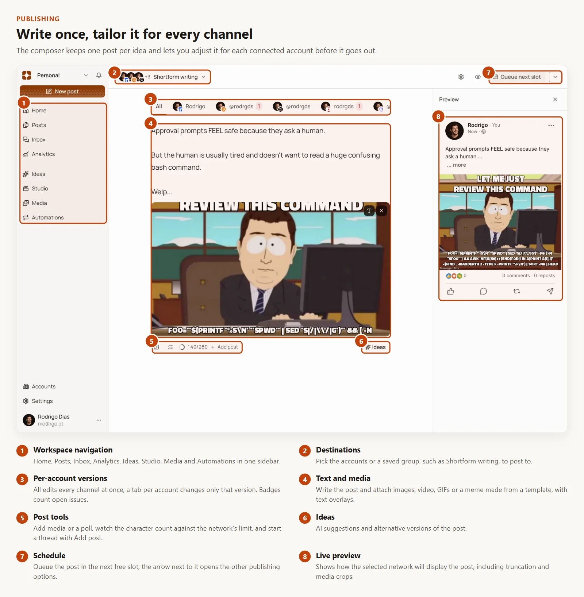
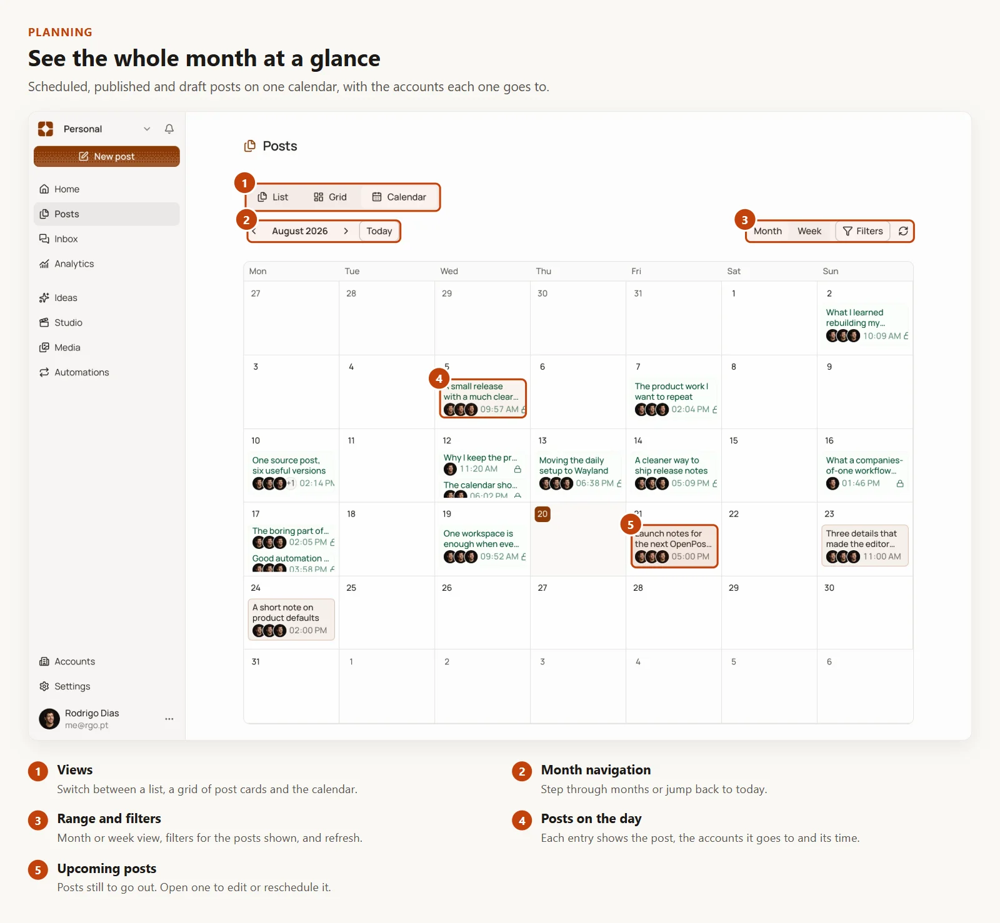
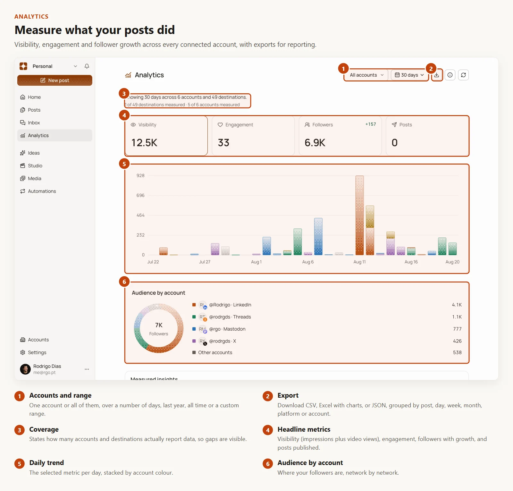
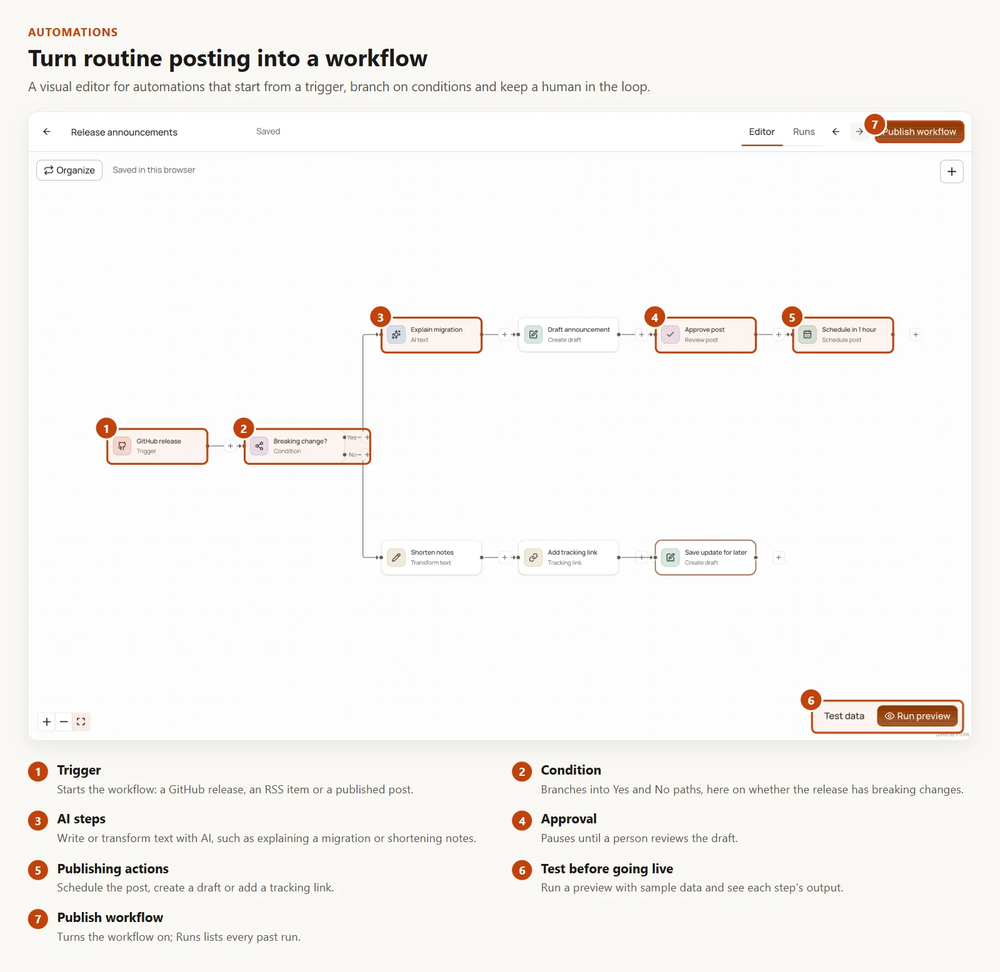
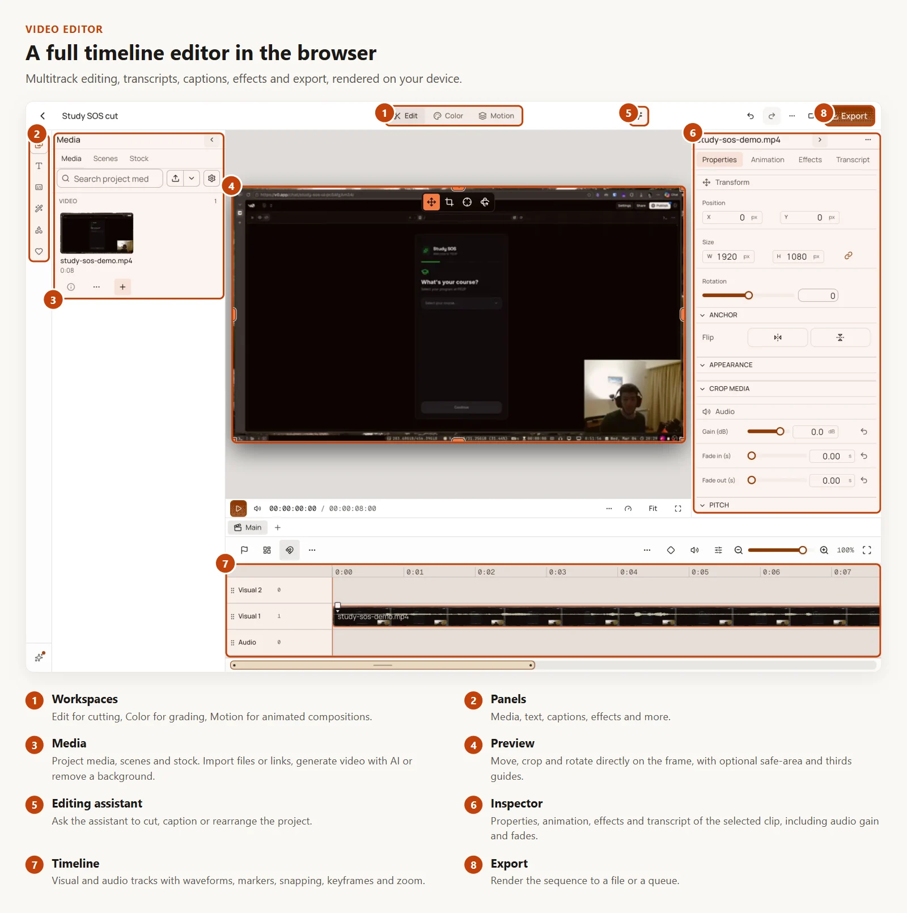
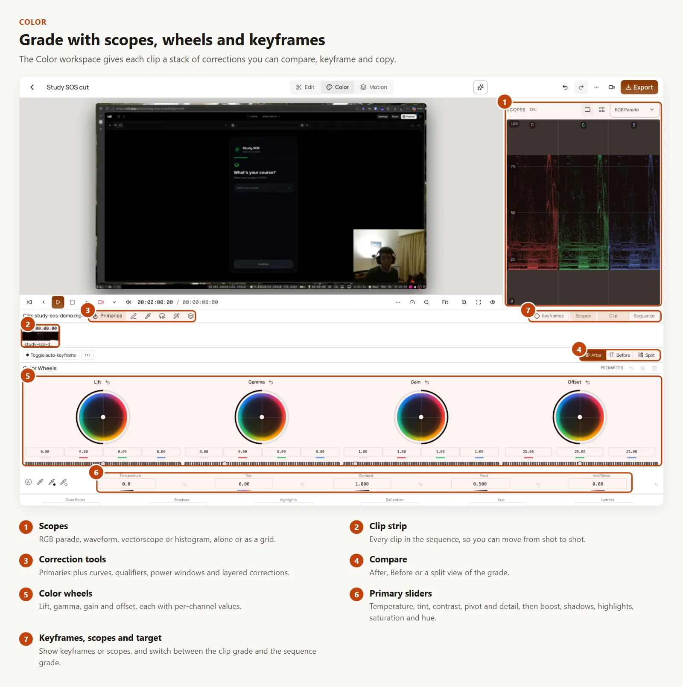
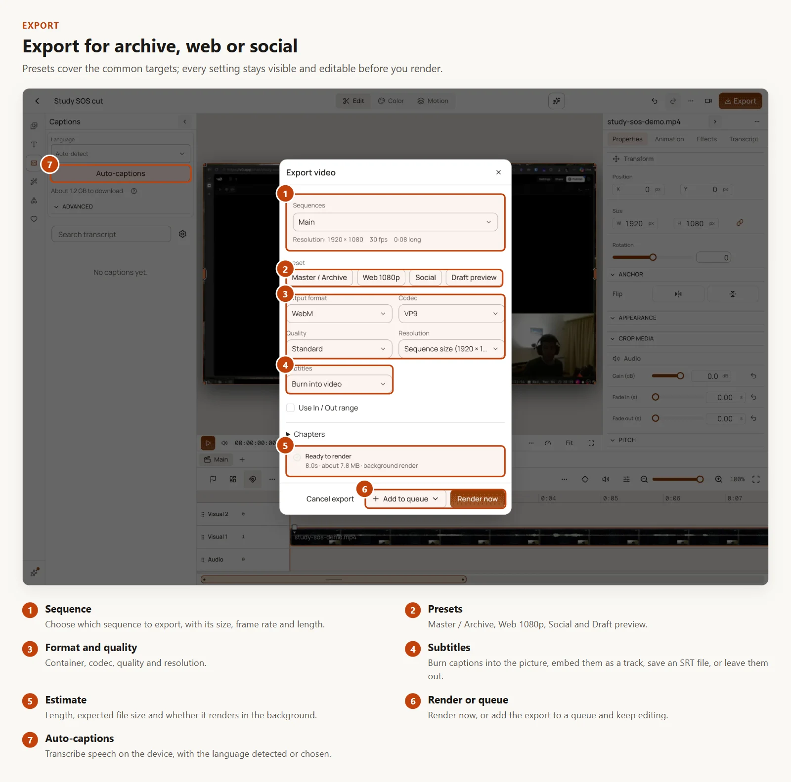
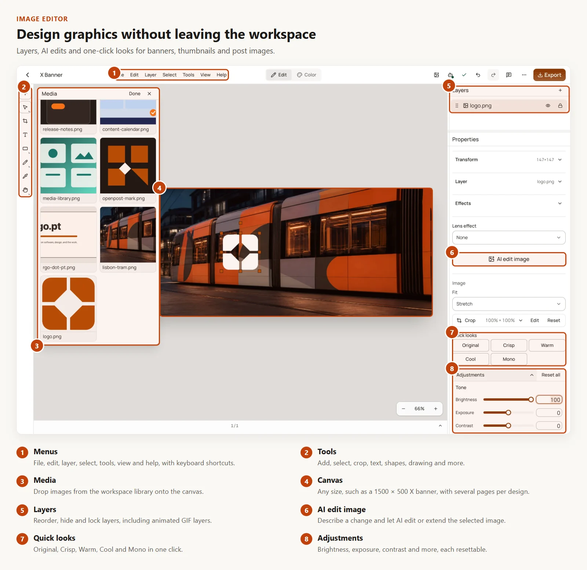

<div align="center">
  <h1>dopost</h1>
  <p><strong>AI-native content creation, motion design, and social publishing in one self-hosted workspace.</strong></p>
  <p>Turn ideas, documents, links, images, and footage into editable videos and channel-ready posts, then publish them and follow the results.</p>

  <p>
    <a href="https://github.com/dhtoan/dopost/releases"></a>
    <a href="https://github.com/dhtoan/dopost/actions/workflows/dopost-phase4-release.yml"></a>
    <a href="LICENSE"></a>
    <a href="https://github.com/dhtoan/dopost/stargazers"></a>
  </p>

  <p>
    <a href="https://github.com/dhtoan/dopost/releases">Releases</a>
    · <a href="apps/docs/content/docs/index.mdx">Documentation</a>
    · <a href="apps/docs/content/docs/self-hosting/index.mdx">Self-hosting</a>
    · <a href="https://github.com/dhtoan/dopost/issues">Issues</a>
  </p>

  <p><strong>English</strong> · <a href="README.vi.md">Tiếng Việt</a></p>
</div>

## Create without losing control

dopost brings AI-assisted creation into a native editing workflow. Generated content stays editable, so a first draft can become a finished production without leaving the workspace.

|                                                                      | Capability                  | What it does                                                                                                                    |
| -------------------------------------------------------------------- | --------------------------- | ------------------------------------------------------------------------------------------------------------------------------- |
|         | **Auto Video**              | Builds an editable video project from a prompt, document, URL, media selection, or structured idea.                             |
|  | **Documentary & Vox Style** | Turns research into ideas, scripts, timed beats, evidence-aware visuals, voice chunks, and motion compositions.                 |
|    | **dopost Motion Engine**    | Applies reusable motion language and deterministic compositions while keeping timing and creative controls editable.            |
|  | **Photo & Video Editors**   | Layers, multitrack timelines, captions, transitions, effects, timers, reusable blocks, audio, and export tools.                 |
|       | **Publishing**              | Adapts, previews, schedules, and publishes content across connected social channels, with polls, first comments, and approvals. |
|         | **Unified Inbox**           | Comments, direct messages, mentions, and Google Business reviews in one place, with AI-drafted replies you review first.        |
|     | **Analytics**               | Visibility totals, follower and engagement trends, custom date ranges, and CSV, Excel, or JSON export.                          |
|     | **Workflows**               | Visual automations from RSS, GitHub releases, and published posts, with AI writing, review, and comment campaigns.              |
|    | **Connected Workspace**     | Media, accounts, calendars, inboxes, analytics, automations, clients, and collaborators together.                               |

## Product tour

Each screen below is a real capture of dopost. The numbers match the notes under each picture.

### Publishing



### Planning



### Analytics



### Automations



### Video Editor







### Image Editor



## What's new in 1.2

**Colour**

- **Source profiles** for Apple Log, Apple Log 2, HLG and PQ footage, decoded through the ACES 2.0 output transform.
- **HDR to SDR** conversion for HLG and PQ clips, detected on import.
- **Match a shot**: grade one clip to look like a reference clip.

**Editing**

- **Block out shots** from a typed shot list, then fill them with footage later.
- **J/L split edits**: start a clip's sound early or let it run over the next shot.
- **Sync a recording by sound** to the camera clip.
- **Remove background** from a video on the device with MediaPipe.

**Captions**

- **Sync your own lyrics or script** to the audio.
- **Snap captions to speech**, checked against the clip's audio.
- The **editor agent** can caption, clean up and translate captions.

**Export and sharing**

- **Loudness target** (LUFS) in the export dialog.
- **Finish on server** with ffmpeg to ProRes 422 HQ, H.265 or a smaller H.264 (off by default).
- **Read-only share links** for video projects.
- **Import video page links** through yt-dlp (off by default).

  1.1 added AI video generation, the ChatGPT video player, preview guides and word-accurate speech cleanup. See [all releases](https://github.com/dhtoan/dopost/releases) for the full notes.

## Built for editable output

AI output should be a starting point, not a locked render. dopost creates native project state that you can refine in the editor: rearrange scenes, rewrite copy, retime voice, replace media, change motion, and export again.

- **Source-aware workflows**: carry evidence and creative intent from research into the final sequence.
- **Deterministic motion**: reproduce compositions consistently while keeping manual control.
- **Production continuity**: move from generation to editing, review, scheduling, and publishing in one system.
- **Self-hosted ownership**: run the application yourself and keep control of project data and media.

## Get started

### Run with Docker

Every release publishes a container image, `ghcr.io/dhtoan/dopost`, tagged with the version (for example `1.2.0`) and `latest`. To run it from a clone of this repository:

```bash
cp deploy/aapanel/.env.example deploy/aapanel/.env
# Set the public URL and the secrets in deploy/aapanel/.env.
# Pin the version with DOPOST_IMAGE_TAG=1.2.0.
docker compose -f deploy/aapanel/docker-compose.yml up -d
```

The app listens on `127.0.0.1:8080`; put a reverse proxy with TLS in front of it. The [aaPanel deployment guide](docs/deployment/aapanel.md) covers the proxy, PostgreSQL and S3-compatible storage. Compose files for CasaOS, Coolify, Dockge, Dokploy, Portainer and ZimaOS are in [`deploy/`](deploy).

To upgrade, take a backup (**Settings → Instance → Backup and restore**), change `DOPOST_IMAGE_TAG`, then run `docker compose -f deploy/aapanel/docker-compose.yml pull` and `up -d` again. Each release's notes list its migrations and new settings.

### Run the development workspace

Requirements: [Bun 1.3.11](https://bun.sh/), Go, and the platform dependencies reported by the project doctor.

```bash
git clone https://github.com/dhtoan/dopost.git
cd dopost
bun install --frozen-lockfile
bun run doctor
bun run dev
```

Useful commands:

```bash
bun run check
bun run test
bun run build
```

## Technology

dopost uses Go for the backend and media services, with SvelteKit and TypeScript for the web app. Bun runs the JavaScript workspace. SQLite and local media storage are the simple self-hosted default; PostgreSQL and S3-compatible storage are available for larger deployments.

## Release status

dopost uses semantic versioning. Releases can still change APIs, configuration or migrations, and the release notes say so when they do. Pin the exact version, keep backups, and test upgrades before using them with important projects.

## Contributing

Bug reports and focused proposals are welcome through [GitHub Issues](https://github.com/dhtoan/dopost/issues). Include the version, deployment method, reproduction steps, expected result, and relevant logs with secrets removed.

## License

dopost is distributed under the [GNU Affero General Public License v3.0 only](LICENSE). Third-party components keep their own licences and notices; see [NOTICE.md](NOTICE.md) and the [licenses directory](licenses/README.md).

The licence covers the code, not the dopost name or logo. Forks and hosted services need their own name; see the [trademark policy](TRADEMARKS.md).
