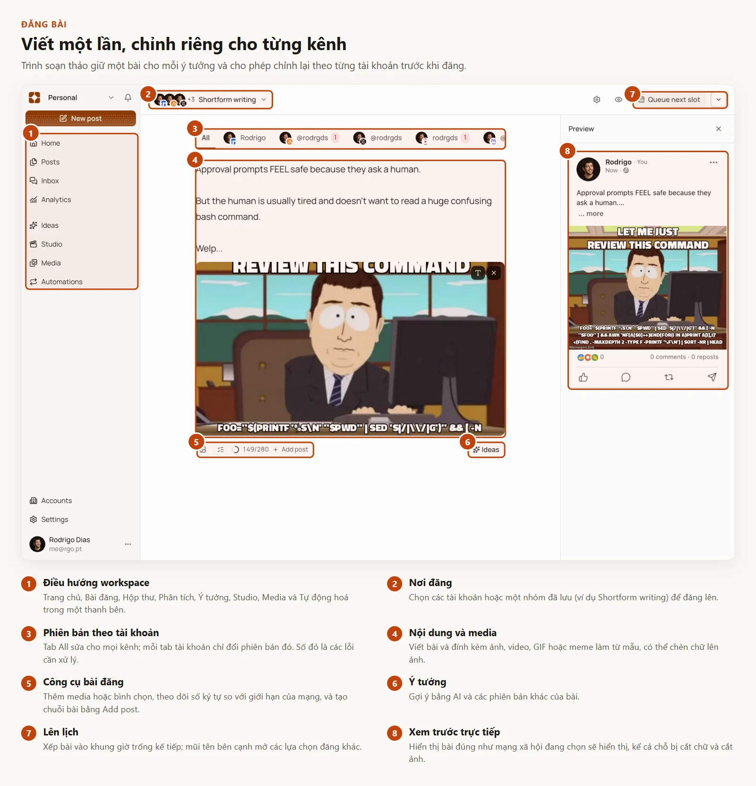
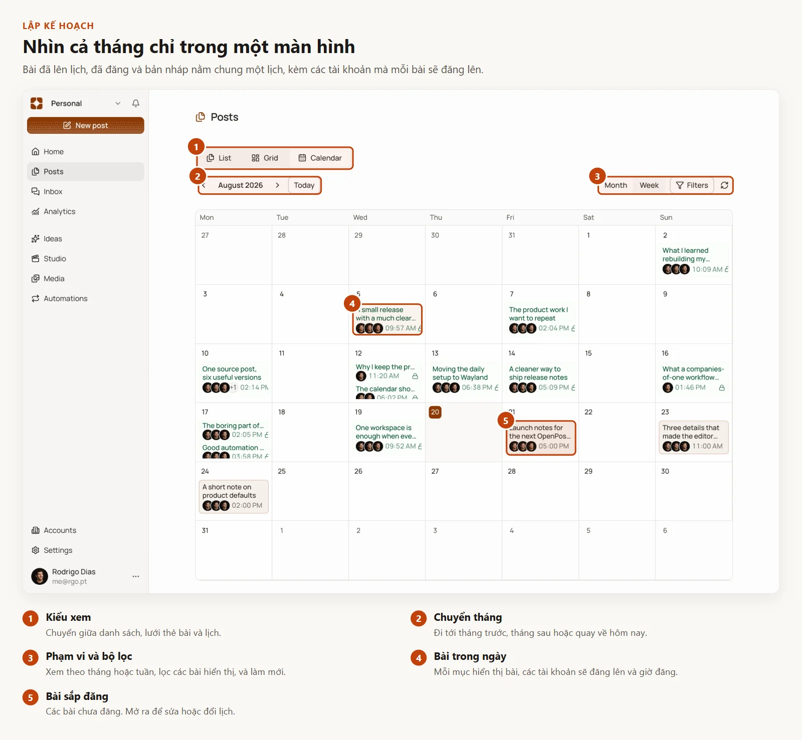
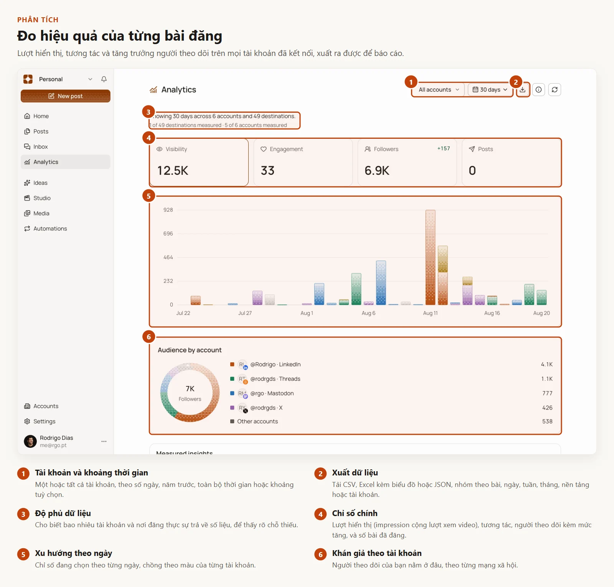
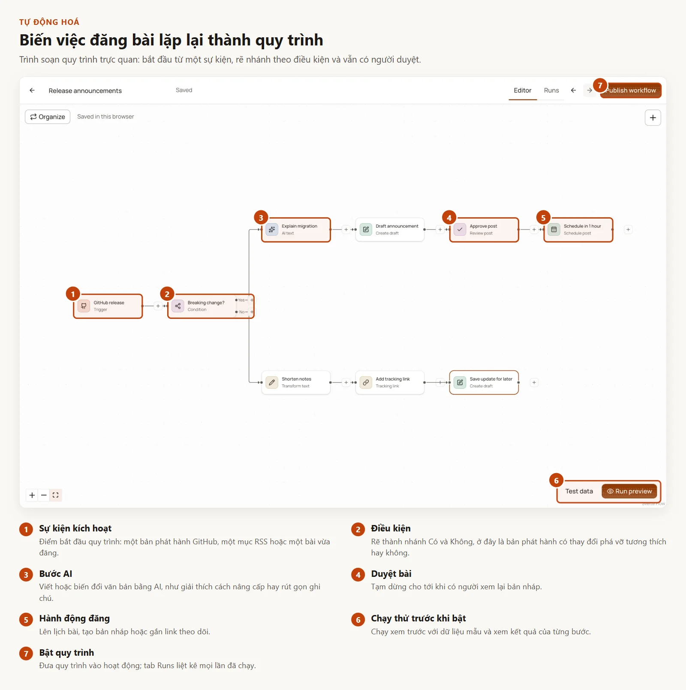
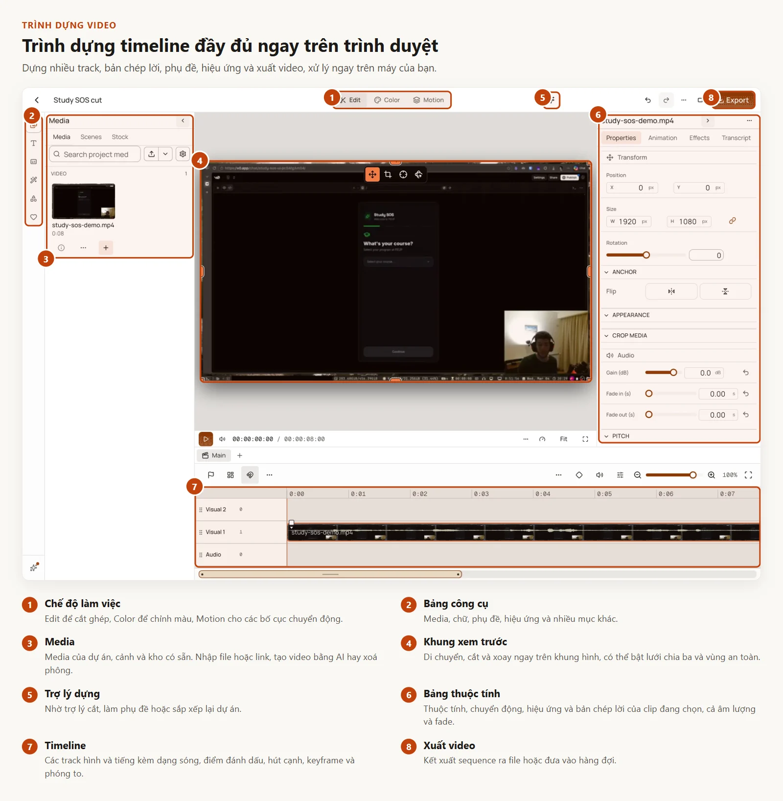
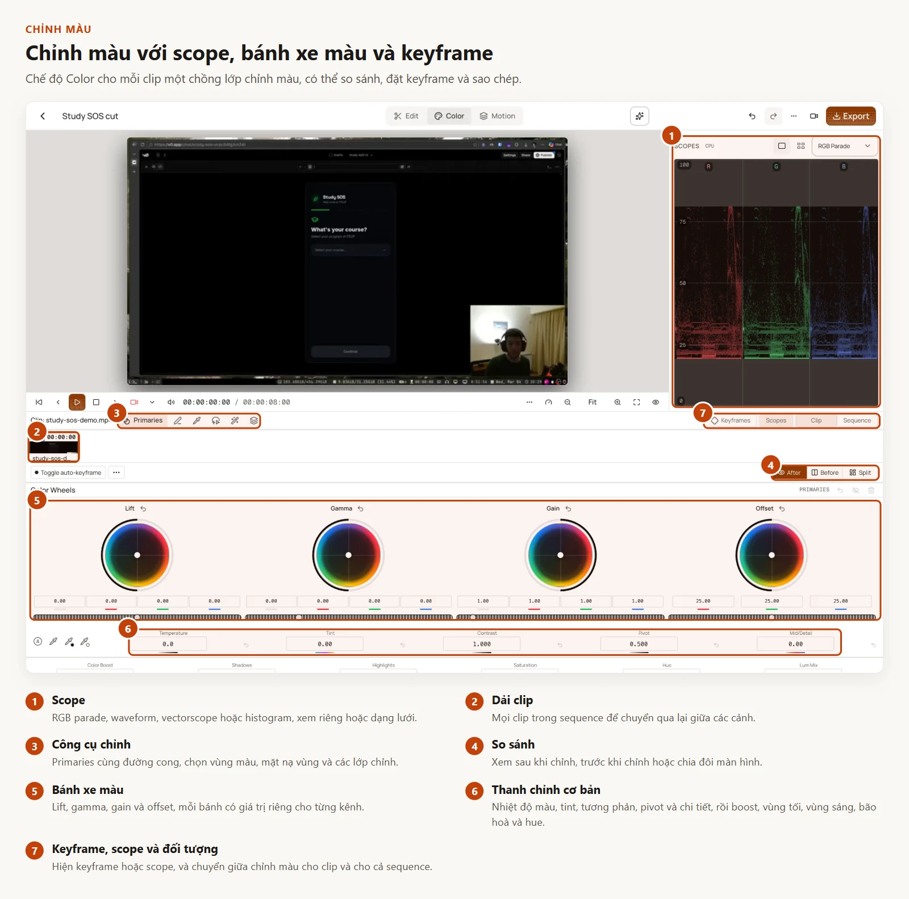
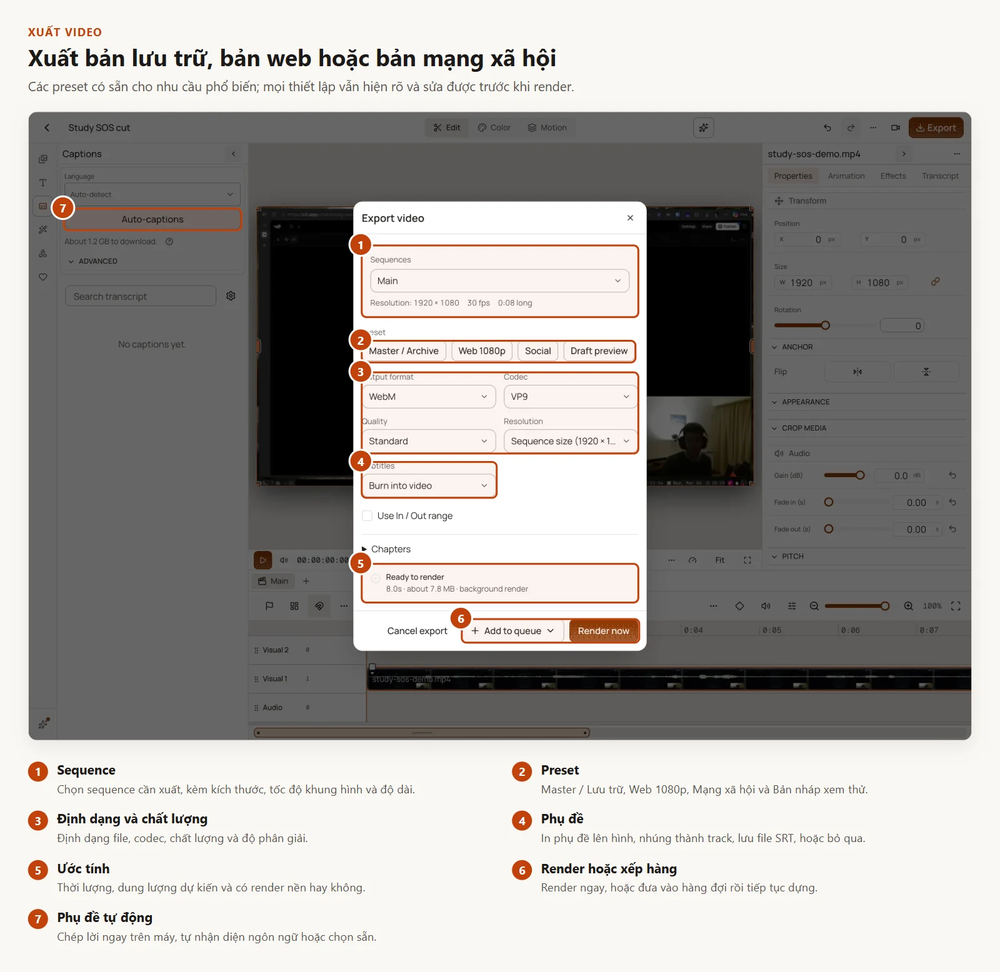
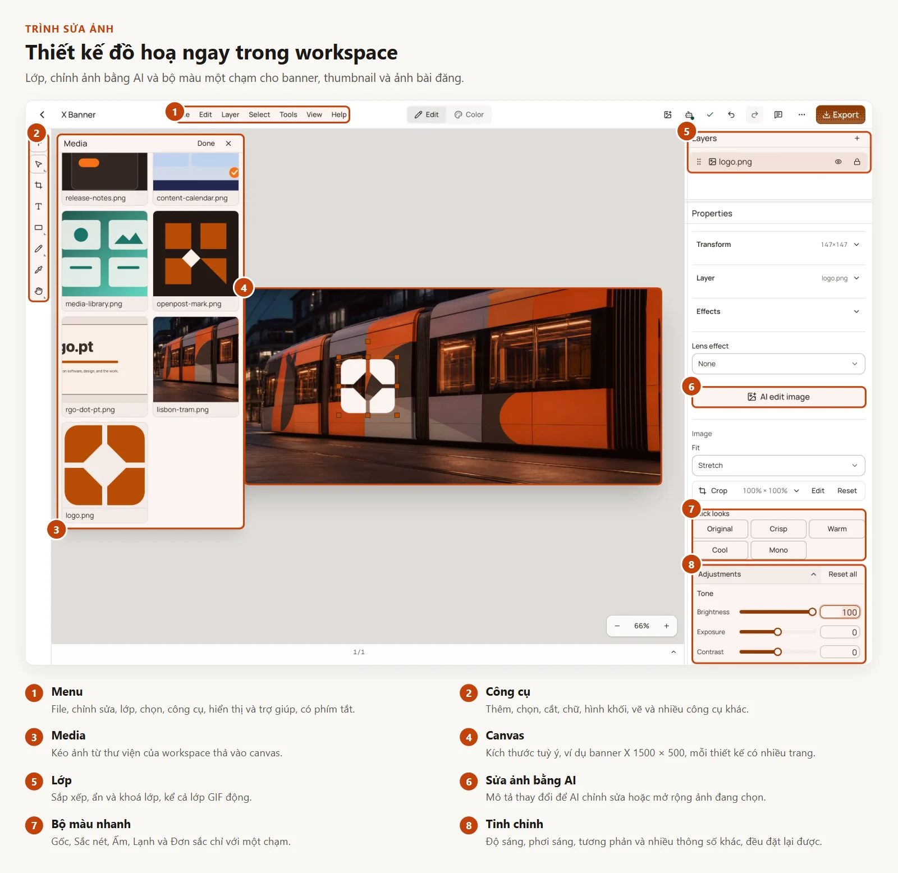

<div align="center">
  <h1>dopost</h1>
  <p><strong>Tạo nội dung bằng AI, thiết kế chuyển động và đăng mạng xã hội trong một workspace tự host.</strong></p>
  <p>Biến ý tưởng, tài liệu, đường link, hình ảnh và cảnh quay thành video chỉnh sửa được và bài đăng sẵn sàng cho từng kênh, rồi đăng và theo dõi kết quả.</p>

  <p>
    <a href="https://github.com/dhtoan/dopost/releases"></a>
    <a href="https://github.com/dhtoan/dopost/actions/workflows/dopost-phase4-release.yml"></a>
    <a href="LICENSE"></a>
    <a href="https://github.com/dhtoan/dopost/stargazers"></a>
  </p>

  <p>
    <a href="https://github.com/dhtoan/dopost/releases">Bản phát hành</a>
    · <a href="apps/docs/content/docs/index.mdx">Tài liệu</a>
    · <a href="apps/docs/content/docs/self-hosting/index.mdx">Tự host</a>
    · <a href="https://github.com/dhtoan/dopost/issues">Báo lỗi</a>
  </p>

  <p><a href="README.md">English</a> · <strong>Tiếng Việt</strong></p>
</div>

## Sáng tạo mà vẫn làm chủ

dopost đưa AI vào ngay trong quy trình dựng và biên tập. Nội dung do AI tạo vẫn chỉnh sửa được, nên bản nháp đầu tiên có thể trở thành sản phẩm hoàn chỉnh mà không phải rời workspace.

|                                                                      | Tính năng                     | Làm được gì                                                                                                                                |
| -------------------------------------------------------------------- | ----------------------------- | ------------------------------------------------------------------------------------------------------------------------------------------ |
|         | **Auto Video**                | Dựng một dự án video chỉnh sửa được từ câu lệnh, tài liệu, đường link, media đã chọn hoặc ý tưởng có cấu trúc.                             |
|  | **Phong cách tài liệu & Vox** | Biến tư liệu nghiên cứu thành ý tưởng, kịch bản, nhịp dựng có thời lượng, hình minh hoạ bám theo dẫn chứng, lời đọc và bố cục chuyển động. |
|    | **dopost Motion Engine**      | Áp dụng ngôn ngữ chuyển động dùng lại được và bố cục có tính tất định, trong khi thời gian và các tuỳ chỉnh sáng tạo vẫn sửa được.         |
|  | **Trình sửa ảnh & video**     | Lớp, timeline nhiều track, phụ đề, chuyển cảnh, hiệu ứng, đồng hồ đếm, khối dùng lại, âm thanh và công cụ xuất file.                       |
|       | **Đăng bài**                  | Điều chỉnh, xem trước, lên lịch và đăng nội dung lên các kênh đã kết nối, có bình chọn, bình luận đầu tiên và quy trình duyệt.             |
|         | **Hộp thư chung**             | Bình luận, tin nhắn, lượt nhắc tên và đánh giá Google Business ở một nơi, kèm câu trả lời do AI soạn để bạn duyệt trước.                   |
|     | **Phân tích**                 | Tổng lượt hiển thị, xu hướng người theo dõi và tương tác, khoảng ngày tuỳ chọn, xuất CSV, Excel hoặc JSON.                                 |
|     | **Quy trình tự động**         | Tự động hoá trực quan từ RSS, bản phát hành GitHub và bài đã đăng, có bước viết bằng AI, duyệt bài và chiến dịch bình luận.                |
|    | **Workspace liên thông**      | Media, tài khoản, lịch, hộp thư, phân tích, tự động hoá, khách hàng và cộng sự ở cùng một chỗ.                                             |

## Tham quan sản phẩm

Mỗi ảnh dưới đây là ảnh chụp thật của dopost. Các số trên ảnh khớp với phần giải thích bên dưới ảnh.

### Đăng bài



### Lập kế hoạch



### Phân tích



### Tự động hoá



### Trình dựng video







### Trình sửa ảnh



## Có gì mới trong bản này

- **Hộp thư chung**: nhận lượt nhắc tên từ Bluesky, Mastodon và Threads; đánh giá Google Business và phản hồi của chủ doanh nghiệp; câu trả lời AI soạn từ thông tin sản phẩm đã duyệt; trả lời riêng trên Instagram; đánh dấu đã đọc tất cả trên nhiều trang.
- **Phân tích**: chỉ số Lượt hiển thị gộp impression và lượt xem video; khoảng năm trước, toàn bộ thời gian và khoảng tuỳ chọn; xuất CSV, Excel (kèm biểu đồ) hoặc JSON theo bài, ngày, tuần, tháng, nền tảng hoặc tài khoản.
- **Sao lưu và khôi phục instance** cho bản tự host, tại **Settings → Instance → Backup and restore**.
- **Instagram không cần Trang Facebook**: kết nối trực tiếp tài khoản Business và Creator, hoặc tiếp tục dùng Facebook Login.
- **LinkedIn Community Management** cho Trang và số liệu phân tích.
- **Trình sửa ảnh**: lớp GIF động có chỉnh từng khung hình, hiệu ứng ánh sáng (flare, starburst, sương mù, lăng kính, bokeh), kích thước canvas riêng cho từng trang, preset hiệu ứng lớp, tạo và sửa ảnh bằng AI.
- **Khách hàng và duyệt bài**: vai trò khách hàng có thể kết nối tài khoản và duyệt các bài được giao, kèm nhắc duyệt và thông báo hết hạn.
- **Quy trình và Ideate**: trình soạn quy trình trực quan, chuỗi bài có nguồn dẫn, và bốn phương án bài đăng hoàn chỉnh từ một ý tưởng.
- **Trình dựng video**: trợ lý dựng chạy trên server, làm sạch bản ghi âm, gợi ý clip, đồng hồ đếm, khối dùng lại, sắp xếp lại track và tách âm thanh.
- **Sẵn sàng cho di động**: Hộp thư trên điện thoại với trò chuyện và bình luận, kiểm tra từng nơi đăng ngay trong trình soạn, và giới hạn tải lên do server công bố.
- **Ngôn ngữ**: giao diện tiếng Nga và tiếng Ý.

## Kết quả luôn chỉnh sửa được

Kết quả từ AI nên là điểm bắt đầu, không phải một bản render bị khoá. dopost tạo ra trạng thái dự án gốc mà bạn có thể tiếp tục chỉnh trong trình dựng: sắp xếp lại cảnh, viết lại chữ, chỉnh lại thời gian lời đọc, thay media, đổi chuyển động và xuất lại.

- **Quy trình bám nguồn**: giữ dẫn chứng và ý đồ sáng tạo từ khâu nghiên cứu tới sequence cuối cùng.
- **Chuyển động tất định**: dựng lại bố cục nhất quán mà vẫn chỉnh tay được.
- **Liền mạch trong sản xuất**: đi từ tạo nội dung sang dựng, duyệt, lên lịch và đăng trong cùng một hệ thống.
- **Tự sở hữu dữ liệu**: tự chạy ứng dụng và giữ quyền kiểm soát dữ liệu dự án cùng media.

## Bắt đầu

### Dùng bản phát hành

Tải gói mã nguồn mới nhất từ [GitHub Releases](https://github.com/dhtoan/dopost/releases). Các bản phát hành là bản thử nghiệm alpha; hãy đọc [tài liệu tự host](apps/docs/content/docs/self-hosting/index.mdx) và thử trong môi trường của bạn trước khi dùng thật.

### Chạy môi trường phát triển

Yêu cầu: [Bun 1.3.11](https://bun.sh/), Go, và các phụ thuộc hệ thống mà lệnh kiểm tra dự án báo ra.

```bash
git clone https://github.com/dhtoan/dopost.git
cd dopost
bun install --frozen-lockfile
bun run doctor
bun run dev
```

Các lệnh hay dùng:

```bash
bun run check
bun run test
bun run build
```

## Công nghệ

dopost dùng Go cho backend và các dịch vụ media, SvelteKit và TypeScript cho ứng dụng web. Bun chạy workspace JavaScript. SQLite và lưu media cục bộ là cấu hình tự host đơn giản mặc định; PostgreSQL và bộ lưu trữ tương thích S3 dùng cho các triển khai lớn hơn.

## Trạng thái phát hành

dopost đang ở giai đoạn alpha. Các bản alpha có thể thay đổi API, cấu hình hoặc migration theo cách không tương thích ngược. Hãy ghim đúng phiên bản phát hành, giữ bản sao lưu và thử nâng cấp trước khi dùng cho dự án quan trọng.

## Đóng góp

Báo lỗi và đề xuất cụ thể xin gửi qua [GitHub Issues](https://github.com/dhtoan/dopost/issues). Vui lòng ghi phiên bản, cách triển khai, các bước tái hiện, kết quả mong đợi và log liên quan (đã xoá thông tin bí mật).

## Giấy phép

dopost được phát hành theo [GNU Affero General Public License v3.0 only](LICENSE). Các thành phần bên thứ ba giữ giấy phép và thông báo riêng của chúng; xem [NOTICE.md](NOTICE.md) và [thư mục licenses](licenses/README.md). Bản tiếng Việt này chỉ để tham khảo; nếu có khác biệt, bản tiếng Anh và văn bản giấy phép gốc được ưu tiên.
